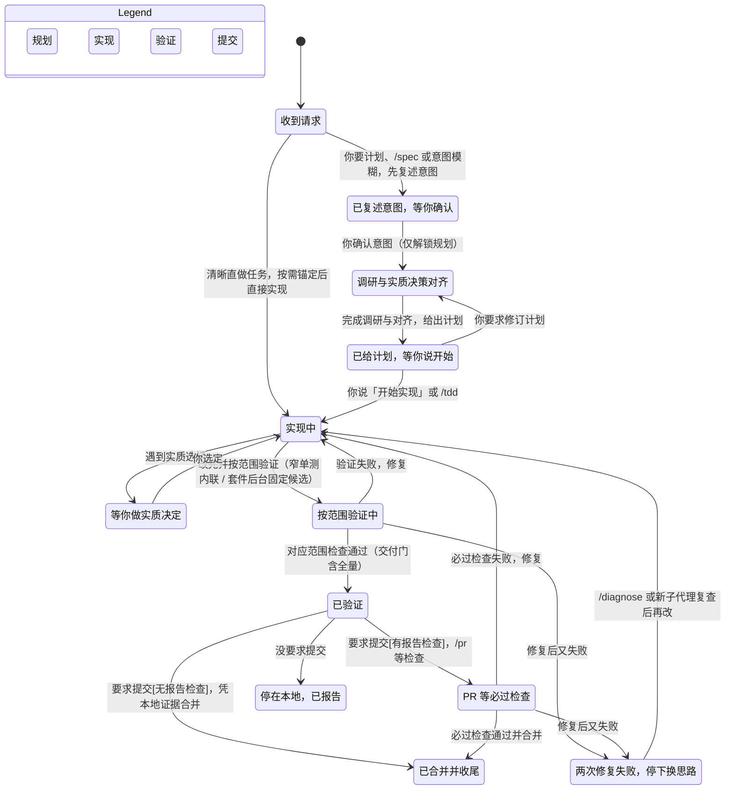

# CosmosSkills

[GitHub](https://github.com/SilentUniverse/CosmosSkills) · [Issues](https://github.com/SilentUniverse/CosmosSkills/issues)

CosmosSkills 是 coding agent 的工程策略层：明确需求、保留必要人审、按行为验证、固定交付候选，
用可追溯证据判断完成。质量与正确性优先，其次交付时间，最后 Token 消耗；结构检查不代表实测收益。

| 所有者 | 职责 |
|---|---|
| Harness（如 ZCode） | Agent runtime、task/session、并行、调度、进程、重试、持久化、resume、上下文、工具与 UI |
| Cosmos | Spec、spec_digest、人审规则、TDD、测试选择与结果判断、Fixed Candidate、Review、Tidy |
| 项目工具 / CI | 测试器、构建器、Git 候选、设备/数据库 fixture、资源互斥与证据留存 |

默认在普通 session 使用已公开工具。不强制 Dynamic Workflow、定时任务、FEATURE.md 或人审页面。
Cosmos 不维护第二套执行状态机；原生任务 completed 也不能代替工程证明。

## 九条定律

SOLID、Clean Code 是下游经验——告诉 AI 该写成什么样，规则一多就记不住。这九条是上游定律——每个词一个问题，让 AI 自己推导；每条在工作流里都有一个指定执行点，强制力分三级——机器红灯、流程必经、自审判据。

| # | 定律 | 它问的一句话 | 在哪被执行 |
|---|---|---|---|
| 1 | First Principles | 为什么？ | `/grill` 从根本推导，不接受类比 |
| 2 | Invariant | 什么必须永远为真？ | FEATURE.md 先写不变量；AC 从不变量推导 |
| 3 | Parsimony | 还能删掉什么？ | 选型阶梯逐级下行；对抗自审问「想象未来的抽象」；spec §3 计划时对每个抽象点名消费者；完成时删除无消费者的新增，深审 `/atk` |
| 4 | Locality | 影响能否限制在这里？ | 切单元算推理半径；过两轴测试的事实走 `/correct` 阶梯 |
| 5 | Provability | 为什么确信它对？ | 等价设计选正确性论证更短者 |
| 6 | Adversarial Review | 怎么把它打爆？ | 高风险 spec 收尾 `/atk`；完成前挑战最可能的失败并对照证据 |
| 7 | Empiricism | 现实数据怎么说？ | 观测压倒推理；性能主张必须带测量 |
| 8 | Reversibility | 错了能回来吗？ | 单向门 `Door: one-way` 单独标出吃最重审查；变更记录对账 |
| 9 | Evolution | 最小正确下一步是什么？ | 首个单元 = 最小可工作核心；宽重构 expand→contract |

---

## 三十秒装上

Windows，clone 完双击 `install.cmd`。

```bash
git clone https://github.com/SilentUniverse/CosmosSkills
```

macOS / Linux。

```bash
git clone https://github.com/SilentUniverse/CosmosSkills
cd CosmosSkills
bash scripts/install.sh
```

装完新开会话，敲 `/` 可检查技能发现情况。只想试试全局规则，不装技能，拉一份 CLAUDE.md 也行。

```bash
curl -fsSL https://raw.githubusercontent.com/SilentUniverse/CosmosSkills/main/claude/CLAUDE.md -o ~/.claude/CLAUDE.md
```

Windows（PowerShell）等价命令；`curl` 裸名在 PS 5.1 是 `Invoke-WebRequest` 别名，必须用 `curl.exe`：

```powershell
curl.exe -fsSL https://raw.githubusercontent.com/SilentUniverse/CosmosSkills/main/claude/CLAUDE.md -o "$env:USERPROFILE\.claude\CLAUDE.md"
```

Codex 在本仓库通过根 [AGENTS.md](AGENTS.md) 读取共享策略 [CLAUDE.md](claude/CLAUDE.md)，避免维护两份正文。
安装器分发 Claude Code/ZCode 配置，并把技能镜像到 `~/.agents/skills`，ZCode 也从该根发现技能。`~/.zcode/skills` 里指向本仓库的镜像链接会在重装时移除，避免每个技能驻留加载两份。不会修改全局 `~/.codex/AGENTS.md`。
显式指定安装目标或 ClaudeRoot 时，不镜像到用户级 ZCode / agents 目录；隔离安装需同时指定这两个路径。
在其他 Codex 项目使用这套常驻策略时，将共享文件的实际路径加入相应 AGENTS.md，并保留原有项目规则。

新项目直接用 `/spec` 起步即可。`.scratch/<feat>/FEATURE.md` 和三态词汇是默认约定；项目命令走
原生入口（`package.json`、`Makefile` 等），入口看不出的前置写进 `AGENTS.md` 的 `## Commands`。无需 setup。`/cosmos-setup` 只处理偏离：非默认
tracker/路径、遗留规划文件折叠进 FEATURE.md、旧 `docs/agents/domain.md` 折叠。

---

## 怎么下指令

日常只需要三个入口：

1. **直接说目标**：小改动、修 bug、解释代码。Agent 按[工作流路由](claude/workflow-routing.md)自己选能力。
2. **`/spec`**：需要先定方案、跨多个会话或涉及公共接口时。先轻探现状并复述你的真实意图（问题、改前→改后例子、IN/OUT 边界、成功判据、AI 补上的假设），**停下等你确认意图**后再深入调研、对齐实质决策并给出计划；计划给出后，回复「好」「可以」只表示认可计划，说「开始实现」「按计划做」或 `/tdd` 才动手。
3. **`/pr`**：提交、推送或合并已验证的改动。

把话说成五行，Agent 就不用猜，每行一句即可：

```text
目标：<要达成的结果>
怎么算做好：<能判定通过或失败的检查，例如某条命令通过、某个页面显示什么>
要看到的证据：<命令输出、截图、改前改后的数字>
已知信息：<报错、日志、复现步骤、链接>
约束：<不能改的文件、接口或行为；先复现；不改代码只调查>
```

Agent 动手前会读完你点名的所有材料，并按风险和跨会话依赖分流：
- **单点明确小改动 / 查事实（S 档）**：零复述寒暄，一句话交代行动与检查后直接执行；
- **单会话多步改动 / 常规修 Bug（M 档）**：2–3 句锚定目标与改前→改后检查点，有需要时用宿主原生步骤列表辅助推进（不建 `.scratch` 文件；若含不可逆决策则先在内联计划确认）；
- **`/spec`、要方案、意图或完成标准模糊、或「我明早看」无人值守**：先检查是否存在 X-Y 伪需求或更窄的可交付切面，结合代码例子复述并**停在这一轮等你确认**后再继续；仅跨多个会话的持久队列才创建 `FEATURE.md`。理解偏了在确认这一步纠正，代价只是一条消息。

常见场景：

| 场景 | 怎么说 | 应该看到的证据 |
|---|---|---|
| 帮我写好提示词 | `/sharpen <粗想法或草稿>` | 4 维专家补深分析（盲区 / 一手材料 / 方法工具 / 外部判据）+ 可直接发出的中文五要素提示词；不改文件不动工 |
| 修 bug | 「修一下 X」+ 复现步骤或报错 | 修复前失败、修复后通过的同一条复现命令；有现成测试框架时补一条回归测试，没补会写明原因 |
| 小改动 | 直接说目标，按上面五行写 | 相关测试或检查的实际输出 |
| 大功能 | `/spec <需求>`，确认后说「开始实现」 | 每个单元的运行日志与 `close` 记录 |
| 审查 | `/atk <目标>`、`/atk -exec <目标>` 或「审一下这个分支」 | 普通模式附文件位置与验证方式；`-exec` 仅保留隔离环境实跑失败并违背意图的硬缺陷，附 `Dropped` 丢弃账单 |
| 持续性能优化 | 明确目标指标与最少迭代轮数，走 [Hillclimb](workflow/TEST-POLICY.md#hillclimb-sustained-metric-optimization) | 7 问基准校验、冻结脚本的改前改后对比、逐轮保留/回滚记录（`hillclimb.tsv`） |
| 问为什么这样设计 | `/show -why <区域>` | 每条理由附 ADR、PR、提交或 blame 出处；查不到写「无记录」 |
| 交付 | `/pr`；只本地提交用 `/pr -local` | PR 链接、检查结果、合并提交 |
| 交给它做、明天验收 | 按五行写清需求，再说「我明早看」 | 起止时间、开头的「需要你看的地方」、逐条验收表、原则检查、以及独立复核对 transcript 与决策日志的真实性审计结论 |
| 回来补课 | `/tidy since <提交或日期>` | 改了什么、等你决定的、风险与缺口三块；不写文件 |
| 复盘返工 | `/correct` | 返工与回滚按错误类别归类；第一次只记类别，同类第二次才落到架构、类型、检查或测试 |
| 配置多模型路由 | `/cosmos-setup -models` | 探测当前宿主可用模型并写入 `~/.cosmos/models.json`（4 档抽象槽位 `deep/fast/panel/cross_judge`，0 常驻字节税） |

交出去做时，默认只在独立分支上本地提交，不推送、不合并；需要更多权限，交代时明说。

较大任务结束时，Agent 报告结果、交付物、跑了哪些检查及结果、没验证的部分和未解决的问题。

验收报告的「原则检查」逐项核对：开头是否转述五项、决策日志是否写、测量是否事先定好选法、
新不变量是否走 `/correct` 阶梯、修 bug 是否补了回归测试。查不到算一条缺陷，记进验收记录。

## 日常流程

主线一图（模型与重跑方法见 [docs/taskflow](docs/taskflow/README.md)；它说明规则怎么写，不证明实际行为）：



入口仍是当前任务。需要判断下一步时，按[工作流路由](claude/workflow-routing.md)选择缺失的能力，
得到结果后回到原任务；不要求依次调用所有 skill。规划先检查真实调用方式、状态归属和验收证据。
改动现有代码时，[影响分析](workflow/spec/impact-detection.md)要点名「这样改是安全的」依赖的一两个事实；
规划阶段证明不了的记为假设，执行阶段再用真实运行证明。UI 与多步流程按
[功能地图字段](workflow/verify/FEATURE-MAP.md)选要覆盖的状态和每个状态的证据。
高风险时序问题可选用[形式化检查](workflow/verify/FORMAL.md)：规划确定性质与范围，授权执行时再
通过 verify 建立或维护检查器，保留反例、代码对应关系和证明边界。状态流转、重试、取消这类问题可用
verify 自带的[状态图检查](workflow/verify/STATECHART.md)：写一个小 TLA+ 模型跑 TLC，得到用读者语言
标注的状态图和每条被破坏规则的最短路径，再回放到真实代码。需要 Java 11+ 与 Node 22.18+，
TLC 随仓库提供，不需要联网。规划遇到重试、取消、恢复、并发写或较多用户可见状态时会出图给你审：
内联计划放在对话里，大功能写进 FEATURE.md 的 `## 状态图`，审核页嵌入 Pele 渲染的图（首次渲染需联网安装 Pele）。

多 agent 的[分工与验收规则](claude/delegation.md)区分覆盖分工、方案比较和独立找错，跨宿主多模型与跨厂商裁判通过[能力槽位路由](claude/model-routing.md)（`deep` / `fast` / `panel` / `cross_judge`）按需读取 `~/.cosmos/models.json`，技能正文不写死具体模型型号，宿不支持时如实降级并披露实际 `model`/`vendor`/`cross_vendor`。
测试默认由子 agent 在后台跑，开发不停下等结果；只有收尾、提交和依赖结果的步骤才等。
当命令明确指向单测试文件/单用例（首跑同时记下耗时）或同一条命令最近一次实测不超过 60 秒、手上没有可并行推进的活、且运行期间不写工作树时，可以直接内联跑；
全量套件、交付检查、测量比较和独立复核仍走后台固定候选。
比快慢先定选法并用 7 问基准清单校验；持续指标优化走 [Hillclimb](workflow/TEST-POLICY.md#hillclimb-sustained-metric-optimization)；测量和验证结果必须写明提交 SHA 与方法，缺了作废重派一次，仍缺记为缺口。
高风险审查可选跨厂商评委，代码发到外部服务前会先问你。
Cosmos 只定义输入、写入边界和所需证据；实际并发、隔离和恢复沿用宿主与项目工具。

按任务规模选路线，只有第三种落文件：

1. **直接做**：实现后跑一次相关测试；修 bug 时有便宜的本地测试路径就补回归测试；要提交时用 `/pr`。
2. **先想清楚**：先复述意图并等你确认，再在对话或原生 plan mode 里给出内联计划，确认开工后实施；不建文件，不跑工件检查。
3. **跨多个会话的大功能**：`/spec` 先复述确认意图，再写唯一的 `.scratch/<feat>/FEATURE.md`（先定合同与人审，再做环境 `prepare` 与预检）。
   无论说「开始实现」还是 `/tdd <feat>`，单元都经 `workflow-state.py start` 准入与 `close` 收口后本地 commit：无记录门特性用 `workflow-state.py run` 日志，含 `Door: one-way` 或 `review: required` 的人审特性用 `evidence.py` 固定候选回执（见 [FULL-SUITE.md](workflow/tdd/FULL-SUITE.md)）。由执行 Agent 根据依赖、写入范围和资源自行决定是否并行。

人审：`Review: human` 的方向性决策在对话里确认（落 `Confirmed: YYYY-MM-DD` 后在审核页折叠到页底参考区）；只有 `Door: one-way`（公共接口、不可逆迁移）或
`review: required` 才走确定性审核页并记录接受，未接受前相关单元不能开工。`## 尚未明确` 中的 `[blocking]` 阻断项未清除前禁止「全部确定」，非阻断 `Q#` 变更不连坐无关已批准单元。
审核页顺序：需要你决定的放最上，其次核对目标、需求、不变量与状态图，然后提交；已确认决策和 AI 工程决策折叠在页底。

上下文用尽时：在单元边界 `/handoff`（单元已 close 并提交，再写一张指针卡片），新会话 `/resume`
（读卡片、`git log`、`survey` 核对状态，只在工作区与最后检查点不一致时重跑验证）。

全量测试只在交付候选上跑一次。一个有效检查可以覆盖多个单元；单元完成、会话恢复或人审提交都不自动跑全量。

| 场景 | 入口 |
|---|---|
| 发指令前把粗想法改深 | `/sharpen <草稿>` |
| 规划或修改需求 | `/spec <需求>` |
| 实施一个单元 / feature | `/tdd <feature> [T<n>]` |
| 跑单元验收命令并留日志 | `python <skills-root>/workflow-state.py run . <feat> T<n> <command>` |
| 完成单元 | `python <skills-root>/workflow-state.py close . <feat> T<n> --evidence "<log>; AC 1"` |
| 查看工程义务 | `python <skills-root>/workflow-state.py survey . --format human` |
| 明确跑全量套件与构建 | `/tdd -all` |
| 设备/日志谓词验证 | `/tdd -log` |
| 上下文快满 / 换会话 | `/handoff` → 新会话 `/resume` |
| 清理 / 只检查 | `/tidy <feature>` / `/tidy inspect <feature>` |
| 某个时间点以来的汇总 | `/tidy since <提交或日期>` |
| 设计依据 | `/show -why <区域>` |
| 方案拿不准、要比几个原型 | `prototype` 多候选：先定选法 → 2–3 个独立工作树 → 选底子嫁接 → 重验 |
| 交付审计用的固定证据 | `python <skills-root>/evidence.py --help` |
| 对抗审查 / 只读审查 / 实跑对抗 | `/atk <目标>` / `/atk -r <目标>` / `/atk -exec <目标>` |
| 配置跨宿主多模型槽位 | `/cosmos-setup -models` |
| 提交当前已验证范围 | `/pr`；只本地提交用 `-local` |

## 工件与审核

- [ARTIFACT-FORMAT.md](workflow/ARTIFACT-FORMAT.md)：FEATURE.md、运行日志与固定 candidate 两种证据、审核记录。
- [TEST-POLICY.md](workflow/TEST-POLICY.md)：scope、跨单元复用、失败分类与同口径性能比较。
- [REVIEW.md](workflow/spec/REVIEW.md)：确定性展示、原始用户事件和人审边界。
- [日常使用](docs/checkpoint-local-release.zh.md)：实时预览与固定候选的区别。

`pending | ready | done` 只描述工程就绪/完成；运行状态仅在 Harness。Done 单元的证据失效或损坏仍拒绝完成。
Git 候选必须覆盖所需脏文件、未跟踪文件和外部输入。批准永远指向预先展示的对象，不绑定点击时 workspace。
HTML bridge 在原生 UI 能保留版本、字段、原始事件及落盘确认前继续提供最小通道；不让模型二次总结批准对象。

## skill

源码分为 [workflow](workflow/README.md) 与 [tooling](tooling/README.md)。主要入口：

| 能力 | 技能 |
|---|---|
| 交接与续接 | [handoff](workflow/handoff/SKILL.md)、[resume](workflow/resume/SKILL.md) |
| 规划、方法与整理 | [sharpen](workflow/sharpen/SKILL.md)（发指令前把提示词改深，不执行任务）、[spec](workflow/spec/SKILL.md)、[tdd](workflow/tdd/SKILL.md)、[tidy](workflow/tidy/SKILL.md) |
| 设计与分析 | [grill](workflow/grill/SKILL.md)、[prototype](workflow/prototype/SKILL.md)、[improve-arch](workflow/improve-arch/SKILL.md)、[codebase-design](workflow/codebase-design/SKILL.md)、[domain-modeling](workflow/domain-modeling/SKILL.md) |
| 审查与修复 | [code-review](workflow/code-review/SKILL.md)、[atk](workflow/atk/SKILL.md)、[diagnose](workflow/diagnose/SKILL.md)、[conflicts](workflow/conflicts/SKILL.md)、[pr](workflow/pr/SKILL.md) |
| 阅读与知识 | [show](workflow/show/SKILL.md)、[research](workflow/research/SKILL.md) |
| 指令维护 | [correct](workflow/correct/SKILL.md)（复盘验收产物；错误第一次只记类别，第二次落到架构、类型、检查或测试）、[write-skill](workflow/write-skill/SKILL.md)、[lint](workflow/lint/SKILL.md)（`-comments` 严格清理代码注释）、[brief](workflow/brief/SKILL.md) |
| 专项工具 | [verify](workflow/verify/SKILL.md)、[record-gif](workflow/record-gif/SKILL.md)、[cpp-oop-style](workflow/cpp-oop-style/SKILL.md)、[cosmos-setup](workflow/cosmos-setup/SKILL.md) |
| 项目配置 | [shell-guardrails](tooling/shell-guardrails/SKILL.md)、[setup-pre-commit](tooling/setup-pre-commit/SKILL.md)、[migrate-to-shoehorn](tooling/migrate-to-shoehorn/SKILL.md) |
| 工程之外 | [teach](workflow/teach/SKILL.md)（多会话学习工作区，只显式调用） |

## 维护

共享策略只改 [claude/CLAUDE.md](claude/CLAUDE.md)。改技能源后，按实际范围运行
`scripts/validate-skills.py` 和必要确定性检查；规则责任变化登记 [RULE-LEDGER.md](workflow/RULE-LEDGER.md)。
行为改进以验收记录为依据，没有记录数据就不宣称；未实际运行的验证如实标明，不据行数或静态检查宣称提速。
安装后的保留 CLI 应独立运行；重装只清理指向本仓的退役技能链接，不删除历史用户证据。
